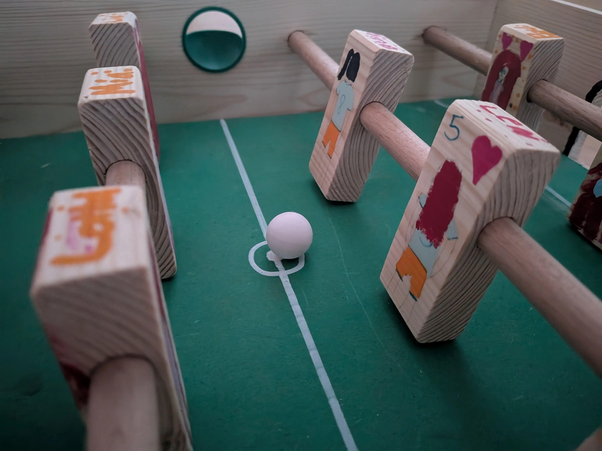
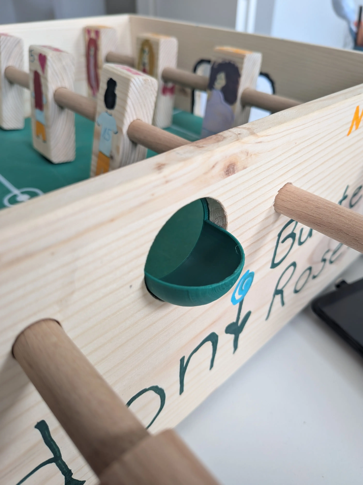
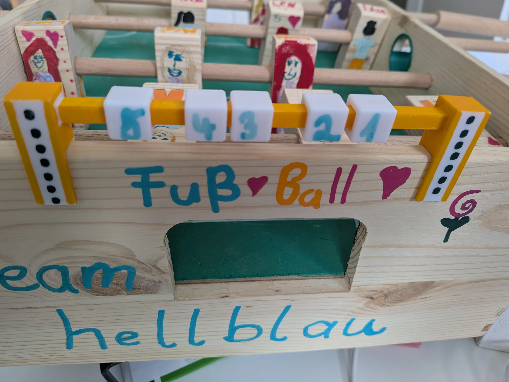

# Kicker

Hier findest du einige 3D-Modelle, die du für deinen Kicker verwenden kannst. Alle Modelle sind im OpenSCAD-Format und parameterisiert, damit du sie an deine Bedürfnisse anpassen kannst.

:::slideshow

:::

:::openscad{id="f02d743d62df48916851135622b23ef18d2d8c80ca65ea782cec4a572b656d67" library="BOSL2"}
::file{path="main.scad" src="./ball.scad"}
:::

:::openscad{id="295c78d069d3db7e67582d8effc706e4bf788dae8a2a53f22a77e611f4c34196" library="BOSL2"}
::file{path="main.scad" src="./entry.scad"}
:::

:::openscad{id="c0c3225922563b158263a717b8f3be032ae5fd7eac142f68f76bf4809ec1e6df" library="BOSL2"}
::file{path="main.scad" src="./score.scad"}
:::
