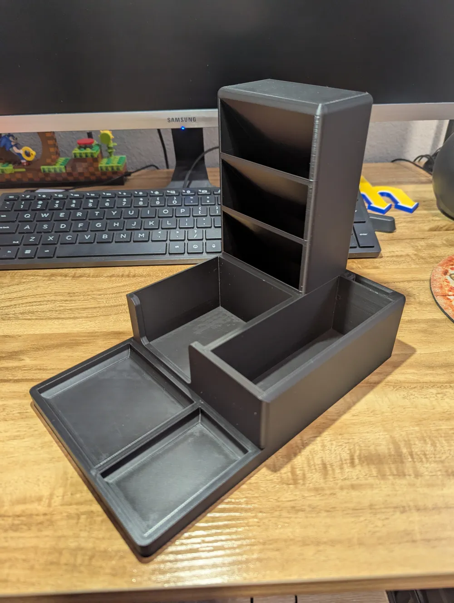
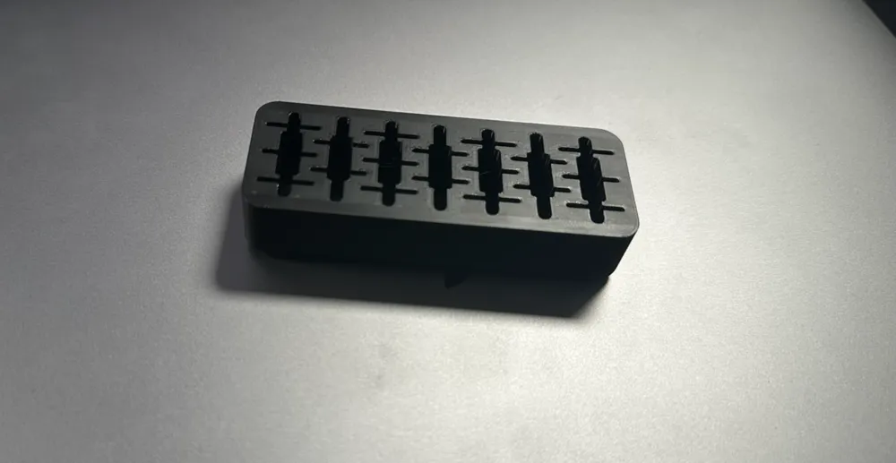

# Organisation

Kleine Helfer für mehr Ordnung auf dem Schreibtisch und am Regal.

## Organizer

Ein Schreibtisch-Organizer mit Fächern für Stifte, Notizen und USB-Sticks bzw. SD-Karten. Das Modell gibt es als STL zum Drucken, der verbindende Winkel zusätzlich als STEP-Datei zum Anpassen in einem CAD-Programm.

:::slideshow

:::

Downloads: [organizer.stl](./organizer.stl), [organizer-usb-sd.stl](./organizer-usb-sd.stl), [Connecting+Bracket.STEP](./Connecting+Bracket.STEP)

## Stifte / Notiz / USB

Kompakter Schreibtisch-Organizer mit einer flachen Mulde für einen Post-it-Block, einem Block mit kreuzförmigen Steckplätzen für SD-Karten und USB-Stecker sowie zwei Stiftbechern dahinter.

:::openscad{id="b7028cda10806f45a0142b929ed645f6bea1ff7defe605756210a107245746ab" library="BOSL2"}
::file{path="main.scad" src="./stifte-notiz-usb.scad"}
:::

## Ablage-Clip

Ein Clip, der auf eine rechteckige Schiene schnappt und Etiketten oder kleine Ablagen aufnimmt. Das Modell ist parametrisch, sodass du es an deine Schiene anpassen kannst.

:::openscad{id="651583ef17892812e089df9120d982b6af5c2526564b701cd708434b44bee7f0" library="BOSL2"}
::file{path="main.scad" src="./ablage-clip.scad"}
:::

## Magnet-Haken

Ein Haken für einen 25 x 3 mm Scheibenmagneten, der durch eine unten liegende Tasche eingesetzt wird. Das Modell liegt bereits in Druckorientierung vor, sodass die Schichten entlang der Belastung laufen.

:::openscad{id="2b6210c0e412d989883ad6acaee228374b3c0c698b129d8681329cb680826a44"}
::file{path="main.scad" src="./magnet_hook.scad"}
:::
